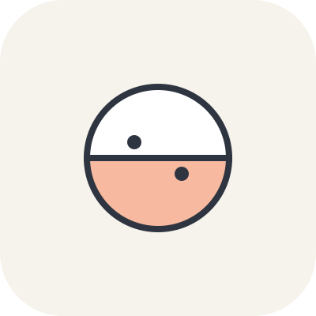

<div align="center">



# TaiJi 台吉 · 吉祥物圖鑑

**山上的綿雲、海岸下的海綿，合成一個圓。**<br>
*Cloudie above the mountain, Spongie below the coast — one circle.*

一隻會隨「地點 × 觸碰 × 季節 × 收集物」變身的台灣吉祥物，以及收集牠所有形態的互動圖鑑。

[](https://github.com/Galen-Chu/Yin-Yang-Tai-Ji/actions/workflows/ci.yml)
[](LICENSE)

</div>

---

## 目錄

- [概念](#概念)
- [玩法](#玩法)
- [內容一覽](#內容一覽)
- [快速開始](#快速開始)
- [專案結構](#專案結構)
- [文件](#文件)
- [開發路線](#開發路線)
- [貢獻](#貢獻)
- [授權](#授權)

## 概念

台吉是一個上下分半的圓：上半是 **綿雲 Cloudie**，下半是 **海綿 Spongie**。
永遠不變的部分只有兩個：**中間那條線**，以及**兩隻眼睛（上下各一隻）**。其他一切都會隨情境改變。

> 每個形態，都是一種溫柔的應對方式。
> *Every form is a gentle way of coping.*

本專案也是一套可重複使用的 **變身角色系統（Changing-Character System）** 的示範：
配方（變化層、規則、檢查點）不變，每個角色是一道新菜。台吉只是第一道。詳見 [`docs/FRAMEWORK.md`](docs/FRAMEWORK.md)。

**一句話測試**：地點・觸碰・季節・收集物，組起來要像在形容一個人。

> 「山巒・長按・冬・山櫻花」→ 山巒般的台吉，先抱住別人的情緒，抱緊一點，熬過寒冷才開花。

## 玩法

| 變化層 | 改變什麼 | 台吉的做法 |
| --- | --- | --- |
| **1 · 地點** Environment | 材質、顏色 | 9 個台灣地景，各自替海綿換色 |
| **2 · 觸碰** Touch + Mood | 形狀、姿態、眼神 | 直接在角色身上做 5 種手勢 |
| **3 · 季節** Time | 世界色調＋一句特質 | 夏＝原色；春淡、秋暖而沉、冬灰冷 |
| **4 · 收集物** Items | 只加配件，不改身體 | 現場打卡取得，最多同時帶 2 件 |
| **5 · 互動** Others | 解鎖隱藏形態 | 跨層的稀有組合＋朋友 |

**觸碰手勢**

| 手勢 | 形態 | 特質 |
| --- | --- | --- |
| 輕點 Tap | 跳跳 Hop | 被推就彈回來，保持溫柔的距離 |
| 長按 Long press | 窩窩 Nestle | 先抱住別人的情緒，再照顧自己 |
| 上下拉 Drag up/down | 飄飄 Drift | 上下分開飄一會兒，輕輕地好奇張望 |
| 連續點 Rapid taps | 抖抖 Tremble | 外表平靜，心裡想很多 |
| 畫圈 Draw a circle | 繞繞 Whirl | 把煩惱轉成慢慢的、穩穩的節奏 |

放著不動約 12 秒，台吉會自己回到原形。

## 內容一覽

| 類別 | 數量 | 說明 |
| --- | --- | --- |
| 形態 Forms | **45** | 9 地點 × 5 觸碰，命名＝地點前綴＋觸碰後綴（山巒跳跳、珊瑚繞繞…） |
| 收集物 Items | **27** | 每個地點 3 件台灣在地物：作物、特有種、地方材料 |
| 隱藏形態 Hidden | **6** | 雲海、綿綿、螢河、黑潮旅人、颱風眼、彩虹台吉 |

**地點**：山巒、森林、梯田、水圳、峭壁、海灘、魚塭、溫泉、珊瑚礁

隱藏形態的解鎖條件刻意不寫在這裡，請到 App 裡解謎 🙂（實作在 [`src/characters/taiji/hidden.ts`](src/characters/taiji/hidden.ts)）。

## 快速開始

需求：Node.js 22.12 以上（建議 24 LTS）。

```bash
git clone https://github.com/Galen-Chu/Yin-Yang-Tai-Ji.git
cd Yin-Yang-Tai-Ji
npm install
npm run dev        # 開發伺服器 http://localhost:5173
```

| 指令 | 用途 |
| --- | --- |
| `npm run dev` | 啟動開發伺服器（HMR） |
| `npm test` | 執行單元測試（Vitest） |
| `npm run typecheck` | TypeScript 型別檢查 |
| `npm run build` | 型別檢查＋產出 `dist/` 靜態網站 |
| `npm run preview` | 預覽建置結果 |

技術棧：**React 19 · TypeScript · Vite · Vitest**。純前端，進度存在瀏覽器 `localStorage`，目前不需後端。

## 專案結構

```
src/
├── core/                  # 角色無關的框架引擎（純 TypeScript，不依賴 React）
│   ├── types.ts           #   變化層的資料型別
│   ├── rules.ts           #   形態判定、隱藏形態條件比對
│   ├── engine.ts          #   純函式狀態機 step(def, state, action)
│   ├── gestures.ts        #   手勢辨識器（輕點／長按／拖曳／連點／畫圈）
│   └── validate.ts        #   內容資料檢查（防止打錯 id）
├── characters/taiji/      # 台吉的內容資料：地點、觸碰、季節、收集物、隱藏形態
├── storage/               # 進度儲存介面＋localStorage 實作
├── ui/                    # React 元件、hooks、樣式
└── App.tsx
docs/
├── FRAMEWORK.md           # 變身角色系統（可重用框架）
├── ARCHITECTURE.md        # 技術架構與擴充指南
└── ROADMAP.md             # 開發路線
```

核心原則：**規則在 `core/`，內容在 `characters/`，畫面在 `ui/`**。
新增地點、收集物或隱藏形態只需改資料檔，不用碰引擎；要做第二個角色，複製 `characters/taiji/` 即可。

## 文件

- [變身角色系統 Framework](docs/FRAMEWORK.md) — 變化層、建構順序、檢查點
- [技術架構 Architecture](docs/ARCHITECTURE.md) — 分層、資料流、狀態模型、如何新增內容
- [開發路線 Roadmap](docs/ROADMAP.md)

## 開發路線

- [x] **M0 · 架構** — 引擎、內容資料、原型級 UI、測試、CI
- [ ] **M1 · 可玩版** — PWA、無障礙、分享形態卡
- [ ] **M2 · 現場打卡** — 地理圍欄取代按鈕打卡、真實季節
- [ ] **M3 · 貼圖試行** — 原形＋5 觸碰形態貼圖組，觀察使用狀況
- [ ] **M4 · 社群** — 雲端同步、朋友互動

完整內容見 [`docs/ROADMAP.md`](docs/ROADMAP.md)。

## 貢獻

歡迎 Issue 與 PR。送出前請確認：

```bash
npm run typecheck && npm test && npm run build
```

新增內容時請遵守 [內容準則](docs/ARCHITECTURE.md#內容準則)：收集物都是**虛擬**的，文案不得鼓勵帶走真實的動植物、珊瑚或礦石。

## 授權

本專案以 [MIT License](LICENSE) 釋出。© 2026 Galen Chu
