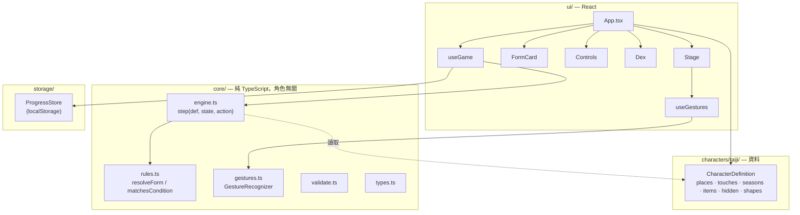

# 技術架構 · Architecture

## 設計目標

1. **框架與內容分離** — 變身規則寫一次，角色內容用資料描述。新增地點／收集物／隱藏形態不用改引擎；做第二個角色只要新增一個資料資料夾。
2. **核心邏輯可測試** — 規則與手勢辨識是純 TypeScript，不依賴 React 或瀏覽器，用單元測試保護。
3. **副作用集中在邊緣** — 儲存、計時器、提示訊息都在 UI 層的 hook 處理，引擎本身是純函式。
4. **先純前端，保留升級路徑** — 進度目前存在 `localStorage`，但透過 `ProgressStore` 介面存取，日後可換成 IndexedDB 或雲端同步。

## 分層



| 資料夾 | 職責 | 可以依賴 |
| --- | --- | --- |
| `src/core/` | 型別、規則、狀態機、手勢辨識、內容檢查 | 無（不得 import React 或 DOM） |
| `src/characters/<id>/` | 一個角色的全部內容資料 | `core/` 的型別 |
| `src/storage/` | 進度的讀寫與資料淨化 | `core/` |
| `src/ui/` | 畫面、互動、副作用 | 以上全部 |

## 狀態模型

```ts
GameState = {
  play: PlayState      // 角色「現在」的樣子，不持久化
  progress: Progress   // 玩家收集了什麼，持久化
}

PlayState = { place, season, touch | null, carried[], friend, history[] }
Progress  = { discovered: string[], collected: string[] }
```

- **形態不存在狀態裡**，而是每次由 `resolveForm(def, play, progress)` 推導出來：
  1. 依優先順序找第一個符合條件的隱藏形態 → `hidden/<id>`
  2. 否則若有觸碰 → `<placeId>/<touchId>`
  3. 否則 → 原形
- `history` 保存最近幾次觸碰（長度 `rules.historyLength`），切換地點或季節時清空，用來判斷「觸碰順序」型的隱藏形態。

## 引擎：`step(def, state, action) → { state, events }`

所有狀態轉換都是純函式。每次轉換後，引擎會把目前形態記入圖鑑（若是新的），並回傳事件給 UI：

| Action | 效果 |
| --- | --- |
| `setPlace` / `setSeason` | 換地點／季節，保留觸碰，清空觸碰歷史 |
| `touch` | 設定觸碰並寫入歷史 |
| `rest` | 回原形（`reason: 'idle'` 表示閒置自動回復） |
| `toggleFriend` | 朋友出現／離開 |
| `toggleCarry` | 帶上／放下收集物（未取得或超過上限會回傳事件而不改狀態） |
| `checkIn` | 在目前地點取得下一件收集物 |
| `goTo` / `becomeForm` / `becomeHidden` | 圖鑑上的「去這裡」「變成這個形態」 |
| `resetProgress` | 清除圖鑑 |

| Event | UI 反應 |
| --- | --- |
| `discovered` | 顯示「新發現」徽章 |
| `itemFound` / `itemLocked` / `carryLimit` / `allFoundHere` / `settled` | 顯示提示訊息 |

## 隱藏形態：宣告式條件

原型裡隱藏形態是寫死的 `if` 判斷；這裡改成資料，所有指定欄位都要符合：

```ts
when: {
  place?: string
  season?: string
  touch?: GestureId
  items?: string[]        // 全部都要帶在身上
  friend?: boolean
  sequence?: GestureId[]  // 最近的觸碰依序等於此序列，且最後一步是目前觸碰
  requires?: string[]     // 這些隱藏形態必須已被發現（連鎖解鎖）
}
```

`hidden` 陣列的順序就是優先順序。`validateCharacter()` 會在測試中檢查所有引用的 id 都存在、所需收集物不超過可攜帶數量等。

## 手勢辨識

`GestureRecognizer` 接收 `down / move / up` 座標，輸出 5 種觸碰之一。時間與計時器可注入，測試時使用假時鐘。

| 觸碰 | 判定 | 預設門檻 |
| --- | --- | --- |
| 跳跳 hop | 單次輕點（等待確認沒有後續連點） | 移動 < 16px，等待 380ms |
| 窩窩 nestle | 長按不動 | > 550ms |
| 飄飄 drift | 以垂直為主的拖曳 | \|dy\| > 60px 且 > \|dx\| × 1.3 |
| 抖抖 tremble | 連續快速點擊 | 1200ms 內 4 次 |
| 繞繞 whirl | 繞角色中心畫圈（拖曳中即觸發） | 累積角度 > 5 rad |

門檻集中在 `DEFAULT_GESTURE_CONFIG`，可依實測調整。手勢旁邊永遠有對應按鈕，作為鍵盤與輔助科技的操作路徑。

## 儲存

- 金鑰：`<characterId>:progress:v1`
- 載入時經過 `sanitizeProgress()`：丟掉已不存在的 id、去除重複、容忍損毀資料。所以內容改版不會讓舊存檔壞掉。
- 若之後資料格式有破壞性變更，把版本號改成 `v2` 並寫遷移函式。

## 如何擴充

### 新增一個地點

1. 在 `characters/taiji/places.ts` 加一筆 `Place`（含 `prefix`、`material`、`palette`）。
2. 在 `items.ts` 為它加 3 件收集物（`placeId` 指向新地點）。
3. `npm test` — 內容檢查與數量測試會提醒你哪裡漏了（記得更新測試裡的 45/27 預期值）。

### 新增一個隱藏形態

在 `hidden.ts` 加一筆 `HiddenForm`，寫好 `when` 條件與 `riddle`／`hint`，並在 `engine.test.ts` 加一個解鎖測試。注意它在陣列中的位置＝優先順序。

### 新增一個角色

1. 複製 `src/characters/taiji/` 為 `src/characters/<新角色>/`，改寫所有內容與 `describe` 句型。
2. 在 `App.tsx` 換掉 `def`（之後可做角色選單）。
3. 跑一次 `validateCharacter()`。框架層 `core/` 不需修改。
4. 授權：框架程式碼是 MIT，新角色的授權由角色作者自行決定；台吉本身是 CC BY-NC 4.0（見 [`LICENSE-CHARACTER.md`](../LICENSE-CHARACTER.md)），複製資料夾當骨架後，請把台吉的內容全部換掉。

## 內容準則

- **收集物一律是虛擬的。** 帝雉羽、黑面琵鷺羽、珊瑚枝、北投石、太魯閣大理石等在現實中受法律保護或禁止採集。文案用「打卡取得」，不得暗示或鼓勵帶走真實的動植物、珊瑚或礦石。
- **一物一特質、一層一職責**：收集物只加配件不改身體；季節只改色調與一句特質。
- 新內容要能通過[一句話測試](FRAMEWORK.md#一句話測試--the-one-line-test)。
- 所有使用者可見文字都要有 `{ en, zh }` 兩種語言。

## 與原型的差異

本架構由 `台吉 TaiJi 互動原型.html` 移植而來，行為保持一致，以下為刻意調整：

| 項目 | 原型 | 現在 |
| --- | --- | --- |
| 地點 id | `mtn`, `woods`, `forest`（峭壁）, `city`（海灘）, `spring`（溫泉） | `ridges`, `forest`, `cliffs`, `beach`, `hotspring`（名實相符） |
| 隱藏形態 | 寫死的 `if` 判斷＋ `typhoon` 旗標 | 宣告式 `when` 條件＋觸碰歷史 |
| 儲存 | 兩個 key（`yunhai-dex-v1`, `taiji-items-v2`） | 單一 key `taiji:progress:v1`，載入時淨化 |
| 清除圖鑑 | 直接清除 | 先確認 |
| 語言 | 元件屬性 | 頁面上的語言切換（EN＋中／中文／EN） |
| 無障礙 | — | `aria-pressed`、焦點外框、`prefers-reduced-motion` |
